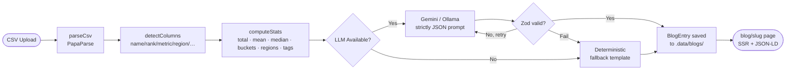

# seo-blog-generator

A Nuxt 3 system that turns any company-ranking CSV into a server-rendered, SEO-optimised blog page using Google Gemini. Built as a take-home test for Beauhurst.

---

## Overview

Upload a CSV → the system detects columns automatically → computes statistics in code → sends the stats to an LLM to write the blog copy → saves the result → renders a fully SSR blog page with structured data, a ranking table, and CSS bar charts.

The key design principle: **numbers are computed in code, not by AI**. This prevents hallucination while still letting the LLM write compelling, varied prose.

---

## How It Works



---

## Setup

### Prerequisites

- **Node.js 20+** (required for `--env-file` flag in the seed script)
- A free [Google Gemini API key](https://aistudio.google.com/apikey) — the system works without one using the fallback template

### Installation

```bash
# 1. Clone / navigate to the project
cd seo-blog-generator

# 2. Install dependencies
npm install

# 3. Set up environment variables
cp .env.example .env
# Edit .env and add your GEMINI_API_KEY

# 4. Seed initial blogs (fintech + healthtech samples)
npm run seed

# 5. Start the dev server
npm run dev
# → open http://localhost:3000
```

### Environment variables

| Variable | Required | Default | Purpose |
|---|---|---|---|
| `GEMINI_API_KEY` | Recommended | — | Google Gemini free-tier key |
| `LLM_PROVIDER` | No | `gemini` | `gemini` or `ollama` |
| `OLLAMA_URL` | No | `http://localhost:11434` | Ollama server (if using local LLM) |
| `NUXT_PUBLIC_SITE_URL` | No | `http://localhost:3000` | Used for canonical URLs and JSON-LD |

---

## How to Generate a New Blog

### Via the upload UI

1. Start the dev server: `npm run dev`
2. Go to [http://localhost:3000/admin/upload](http://localhost:3000/admin/upload)
3. Drag and drop any company-ranking CSV (up to 2 MB)
4. Enter an industry name (optional — inferred from filename if blank)
5. Click **Preview columns** to see what was auto-detected; adjust any roles with the dropdowns
6. Click **Generate blog** — takes 10–20 seconds on the free Gemini tier

### Via the API directly

```bash
curl -X POST http://localhost:3000/api/generate \
  -F "file=@./data/fintech_companies_seed.csv" \
  -F "industry=Fintech"
# → { "slug": "top-100-fintech-companies", "url": "/blog/top-100-fintech-companies" }
```

### Requirements for the CSV

- At least one column that looks like a company name (`Company`, `Name`, `Organisation`, etc.)
- At least one numeric or money column (`Total Raised`, `Funding (USD)`, `Revenue`, etc.)
- Any column separator pattern; multi-value tags should use `;` as the delimiter

---

## Tools Used and Why

| Tool | Why |
|---|---|
| **Nuxt 3** | SSR out of the box; Nitro server handles uploads + storage; file-based routing |
| **Tailwind CSS** | Utility-first; rapid prototyping without bloating the CSS bundle |
| **PapaParse** | Robust CSV parsing: handles quoted fields, BOM, inconsistent line endings |
| **Google Gemini (gemini-2.0-flash)** | Free tier; fast; supports `responseMimeType: 'application/json'` which reduces malformed output |
| **Zod** | Runtime schema validation of LLM output; catches the inevitable occasional garbage response |
| **Nitro storage (fs driver)** | Simple persistence that works locally; swappable for Netlify Blobs / Vercel KV in production |
| **@nuxtjs/sitemap** | Auto-generates `/sitemap.xml` from a dynamic URL source |
| **Vitest** | Fast unit test runner; runs pure TS files directly without Nuxt context |
| **tsx** | Runs the seed script as TypeScript without a separate compile step |

---

## SEO Decisions

- **Single `<h1>` per page**, logical `h2`/`h3` hierarchy
- **`lang="en-GB"`** set globally in `nuxt.config.ts → app.head.htmlAttrs`
- **Canonical links** via `useHead` to prevent duplicate-content penalties
- **Three JSON-LD schemas**: `Article`, `ItemList` (eligible for rich-result carousel), `FAQPage` (eligible for FAQ accordions in SERPs)
- **Full table in server HTML** — search engines can index every ranked company without executing JavaScript
- **`rel="noopener nofollow"`** on external company links — passes no PageRank to third-party sites
- **`/admin` pages are `noindex`** — set via `useSeoMeta({ robots: 'noindex, nofollow' })`
- **Dynamic sitemap** — `@nuxtjs/sitemap` fetches `/api/__sitemap__/urls` which lists every generated blog slug

---

## How AI Accuracy Is Maintained

1. **Numbers computed in code** — `computeStats()` in `analyseDataset.ts` calculates every figure. The LLM never sees raw data, only the pre-computed results.
2. **Explicit instruction in prompt** — "Use ONLY the numbers provided. Do NOT invent, round, or approximate any figures."
3. **Zod schema validation** — the LLM response is parsed and validated against a strict schema. If it fails, a single retry is attempted.
4. **Deterministic fallback** — if the LLM fails (invalid JSON, rate limit, missing API key), `buildFallbackCopy()` generates template-based copy entirely from the `stats` object. The demo never breaks.

---

## My Approach

<!-- TODO: Fill this in with your own words before the interview -->

- ...
- ...
- ...

---

## Limitations

- **Storage**: The `fs` driver writes JSON to `.data/blogs/` on the local filesystem. This is **not durable on serverless platforms** (Vercel, Netlify) where the filesystem is ephemeral. For production, swap the driver: Netlify Blobs, Vercel KV, or Cloudflare KV.
- **No authentication** on `/admin/upload` — anyone with access to the URL can generate blogs. Add an API key check or auth middleware before deploying publicly.
- **Gemini free-tier rate limits** — 15 requests per minute. If you generate many blogs quickly, the fallback template kicks in automatically.
- **CSV size cap** at 2 MB — sufficient for datasets up to ~10,000 rows. Very large CSVs would need streaming parsing.
- **Single currency per dataset** — if a CSV mixes `£` and `$` values, the first currency found wins.

---

## Future Improvements

- **Auth on `/admin`** — Nuxt middleware or a simple bearer token check
- **Cloudflare KV / Vercel KV storage driver** — durable serverless persistence
- **Scheduled regeneration** — a cron job to refresh AI copy as new CSV uploads arrive
- **Multiple datasets per industry** — version history for the same industry (quarterly rankings)
- **Image generation** — use Gemini's image API or DALL-E to generate a hero image per blog
- **Incremental Static Regeneration** — cache blog pages at the CDN layer and revalidate on demand
- **Column-detection confidence scores** — show the user how confident the auto-detection is
- **Export to Markdown** — let users download the generated content for use in other CMSes
